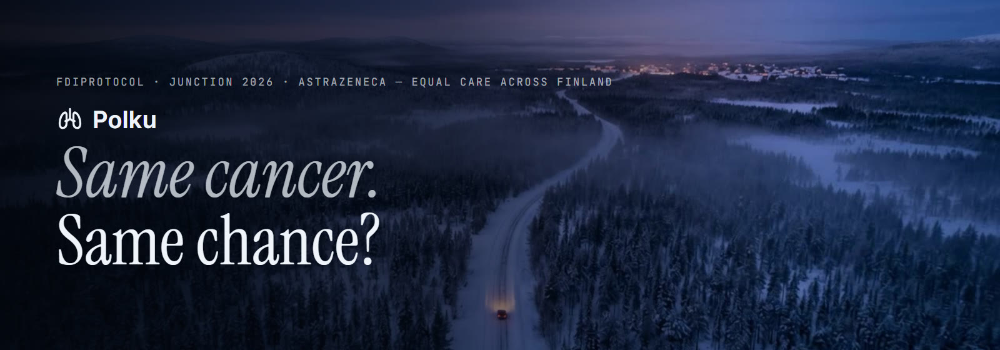
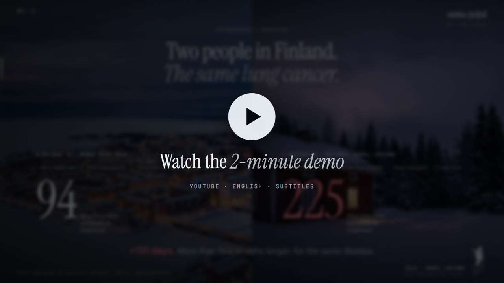
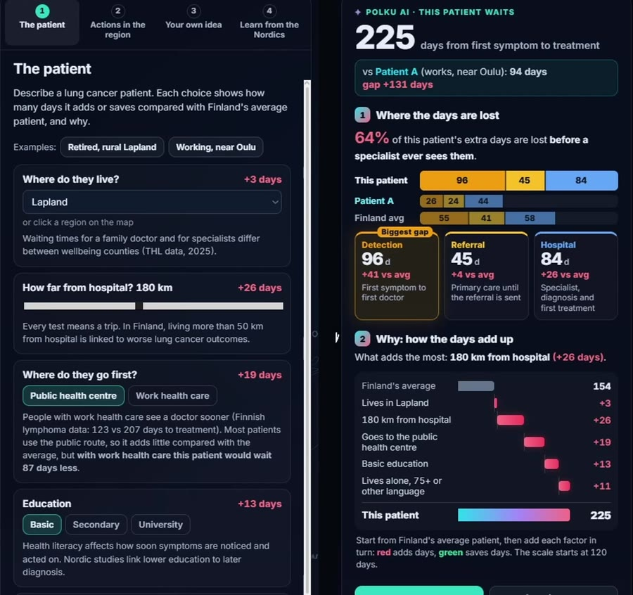
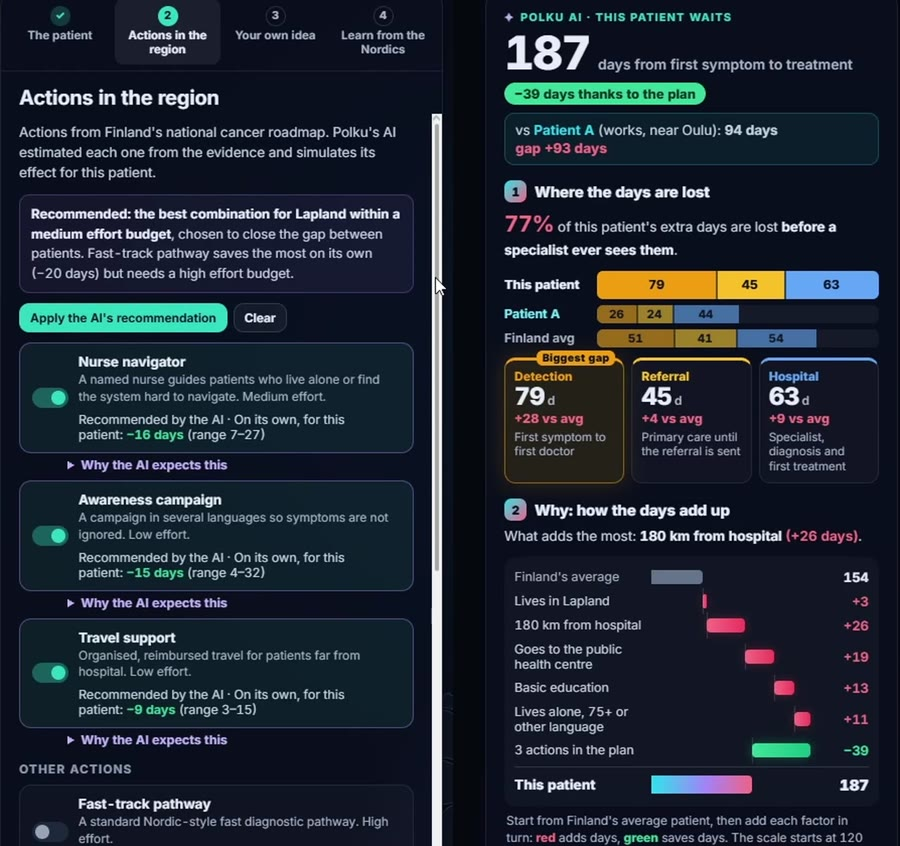
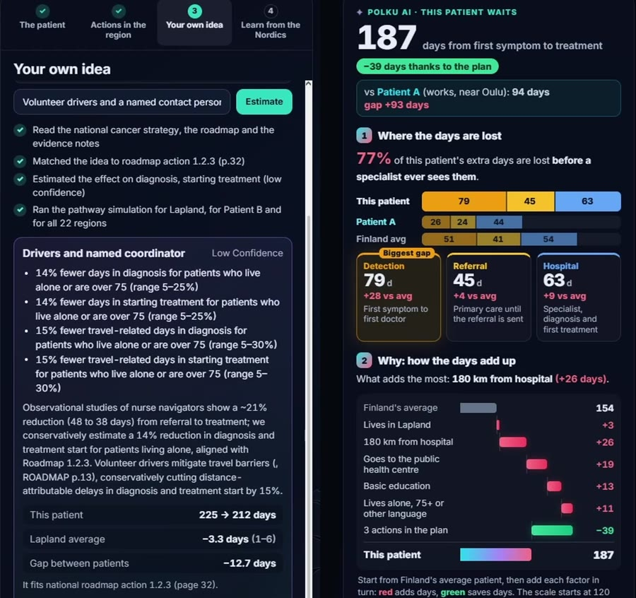
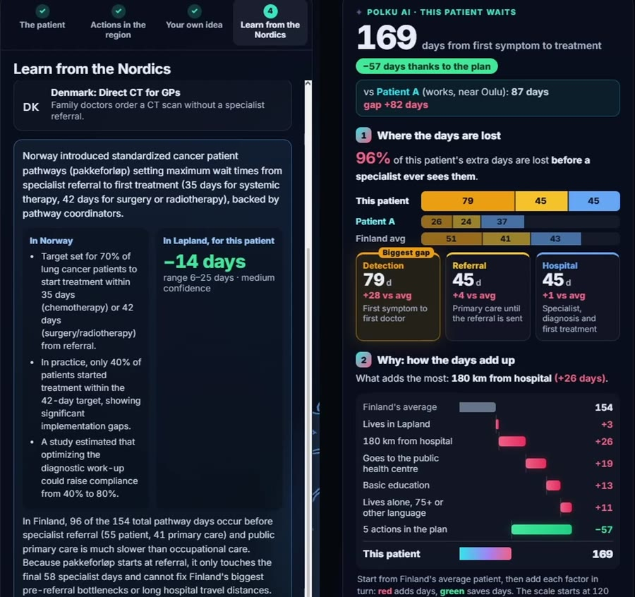
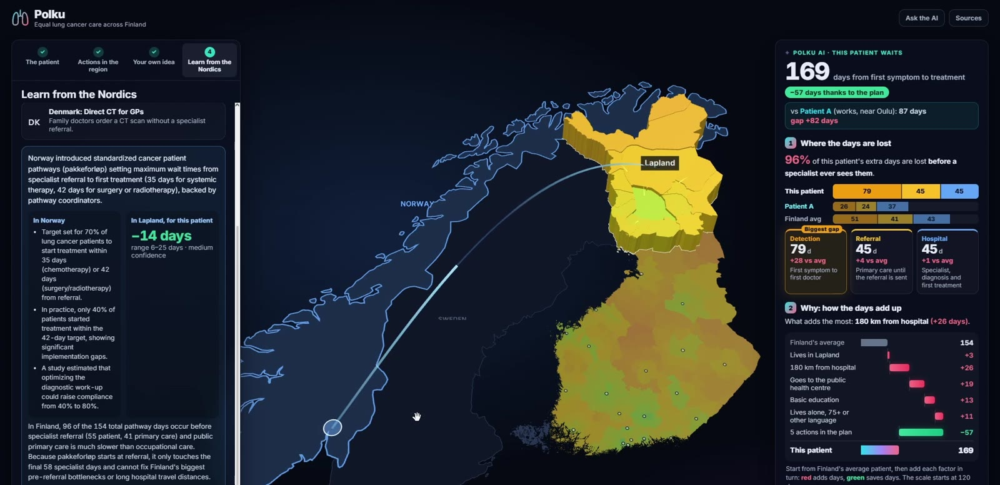
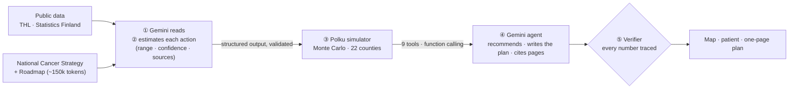

<p align="center">
  
</p>

<h3 align="center">An AI-powered simulator of the lung cancer pathway, in every wellbeing county of Finland.</h3>

<p align="center">
  <a href="https://youtu.be/GxnFY8n3sAc"><b>▶ Demo video</b></a> &nbsp;·&nbsp;
  <a href="https://polku-landing.vercel.app"><b>Pitch</b></a> &nbsp;·&nbsp;
  <a href="https://web-gamma-beryl-747wo4r3t4.vercel.app"><b>Live app</b></a>
</p>

<p align="center">
  
  
  
  
  
</p>

> *"Do two patients with the same cancer in Finland have an equal chance, regardless of where they live, how much they earn, their education, or their ability to navigate the healthcare system?"*
> — the question AstraZeneca asked every team

**Polku** (Finnish for *path*) answers it for lung cancer. It shows **where** in the pathway patients lose time, **why**, and **what each wellbeing county should do first**. Gemini does the reasoning, and Polku's simulator calculates every number.

---

## The gap, in four numbers

<table>
<tr>
<td align="center" width="25%"><h1>94</h1>days<br/><sub>Patient A · works near Oulu · work health care · 8 km from hospital</sub></td>
<td align="center" width="25%"><h1>225</h1>days<br/><sub>Patient B · retired, lives alone · public route · 180 km from hospital in Lapland</sub></td>
<td align="center" width="25%"><h1>64%</h1><br/><sub>of Patient B's extra wait happens <b>before a specialist</b> ever sees them</sub></td>
<td align="center" width="25%"><h1>141k</h1>days<br/><sub>of extra waiting <b>every year</b> in Finland compared with Sweden (~3,000 patients × 47 days)</sub></td>
</tr>
</table>

<sub>Days from first symptom to treatment. Polku simulation on public, aggregated data. Finland 154 · Sweden 107 · Denmark 67 days (Kuittinen et al., preliminary, Yle MOT 2025).</sub>

## What Polku does

| The challenge asks to… | Polku… |
|---|---|
| **Identify the gap** | simulates any patient profile in all 22 wellbeing counties and compares them, so two patients with the same cancer can be set side by side |
| **Locate it in the pathway** | splits the wait into detection, referral and hospital, and builds it up factor by factor from Finland's average (*distance alone adds 26 days*) |
| **Recommend actions** | Gemini estimates the effect of actions from Finland's national cancer roadmap, Polku finds the best mix for each county, and the result is a **one-page plan** in English and Finnish, with the roadmap page for every action |

<p align="center">
  <a href="https://youtu.be/GxnFY8n3sAc"></a>
</p>

## Four steps

<table>
<tr>
<td width="50%"><br/><b>1 · The patient.</b> Where they live, how far from hospital, how they enter care, education and support. Every choice re-runs the simulation and shows how many days it adds.</td>
<td width="50%"><br/><b>2 · Actions in the region.</b> Nine actions from the national roadmap, each estimated by Gemini from the evidence. The best combination for the county comes first, with its reasoning.</td>
</tr>
<tr>
<td width="50%"><br/><b>3 · Your own idea.</b> A planner describes an idea in plain words. Gemini matches it to the roadmap, estimates its effect with a confidence level, and says so when an idea won't help.</td>
<td width="50%"><br/><b>4 · Learn from the Nordics.</b> What Denmark, Norway and Sweden's fast pathways achieved, and what they would mean for this patient in this county.</td>
</tr>
</table>

For Patient B in Lapland: the AI's recommended mix saves **39 days**, a planner's own idea brings it to **48**, and Norway's standardised pathways to **57**, taking the wait from **225 to 169 days**.

<p align="center"></p>

## How the AI works

Gemini is the analyst and the simulator is its calculator. **The language model never produces a final number itself.**



- **Beyond a chatbot.** Gemini reads the full national strategy and roadmap in Finnish (long context). It then estimates each action's effect as structured output: which phases it changes, for whom, by how much, with a pessimistic–optimistic range and a confidence level. Finally, it uses the simulator through function calling.
- **Agent tools:** `list_regions`, `get_region_profile`, `compare_patients`, `find_left_behind`, `simulate_scenario`, `rank_interventions`, `best_plan`, `get_evidence`, `ui_command` (moves the map).
- **Effects with reasons.** The estimates for the 9 actions live in [`data/seed/ai_effects.json`](data/seed/ai_effects.json), each with its reasoning. For example, direct CT access from primary care gets only ~3%, because a Danish trial found no effect.
- **Honest by design.** Every number in an AI answer must come from a tool result, the documents or a published figure. If it doesn't, the UI flags it.
- **Models:** `gemini-4-argon` for estimation and plans, `gemini-3.8-flash` for chat and live ideas (~15 s). Implicit prefix caching serves ~98% of the long context from cache (26 s cold → ~7 s warm).

## The model

- **Pathway phases.** Five phases (first symptom → first contact → referral → specialist → diagnosis → treatment), grouped from AstraZeneca's 8-step pathway and anchored to published Finnish figures.
- **Regional differences** come from real public data: primary-care and specialist waiting times and education (THL Sotkanet), the distance from each of 292 municipalities to its hospital and to radiotherapy, and population and age (Statistics Finland). They are calibrated so the national average is preserved.
- **Patient factors:** entry route (public vs occupational, from Finnish lymphoma data, applied to lung cancer as an assumption), education, and barriers to navigating care.
- **Uncertainty:** lognormal phase durations (Monte Carlo) and an evidence range for every action. There is also a cautious scenario: Patient B's gap is ~131 days with our assumptions and still ~63 days with very cautious ones.
- **Every parameter has a source and a confidence level:** [`data/seed/pathway_parameters.json`](data/seed/pathway_parameters.json).

## Data and transparency

- **Public, aggregated data only.** No patient records. Example patients are synthetic and labelled as such.
- **Sources:** Statistics Finland (2026 boundaries, 2025 population) · THL Sotkanet · National Cancer Strategy 2026–2035 and Implementation Roadmap 2026–2031 · Kuittinen study (Yle MOT 2025, preliminary) · Khalife et al. 2025 · Kuitunen et al. 2026 · Zai et al. 2025 · Nordic pathway evidence (Denmark, Norway, Sweden, Wales) · Natural Earth. The full list, with links and confidence levels, is in [`docs/05_fuentes_y_evidencia.md`](docs/05_fuentes_y_evidencia.md).
- **Limits, said plainly.** Finland does not record symptom-to-treatment times. That is why Polku's first recommendation is always **step 0: start measuring**. The proposed next step is a 3-month pilot with one county, calibrated with real data through Findata.

> Polku is decision support for health care planners. It does not diagnose, treat or predict individual outcomes. It is not a medical device.

## Run it

Requirements: Node 20+.

```bash
npm install
cp .env.example .env     # add GEMINI_API_KEY (never commit it)
npm run dev:server       # API on :8787
npm run dev:web          # app on http://localhost:5173
```

- **No key? It still works.** The simulator and the map run fully in the browser, and with `DEMO_MODE=true` the server replays recorded AI answers from [`demo/`](demo/).
- `npm test` runs the simulation engine's tests: calibration, Shapley attribution, interventions and AI effects.
- `npm run data` rebuilds the public data from Statistics Finland and THL Sotkanet.

```
apps/web        Vite + React + deck.gl: 3D map and simulator
apps/server     Node + @google/genai: agent, effect estimation, design-an-action, Nordic comparison, plan
packages/sim    Pathway simulator (TypeScript, shared by browser and server) + tests
data/           seed parameters, AI effect estimates, processed public data
demo/           recorded AI answers for offline demos
scripts/        public data pipeline, demo video tooling
docs/           challenge, model, sources and decisions (team notes, in Spanish)
```

## Team

**FdiProtocol** · Junction 2026, Helsinki. Built for AstraZeneca's *Equal Care Across Finland* challenge and the Gemini side challenge.

The pitch is a scroll-driven landing with scenes of Finland generated with Gemini (Nano Banana Pro and Omni): [polku-landing.vercel.app](https://polku-landing.vercel.app) · [source](https://github.com/MarcoGarLop/polku-landing).
